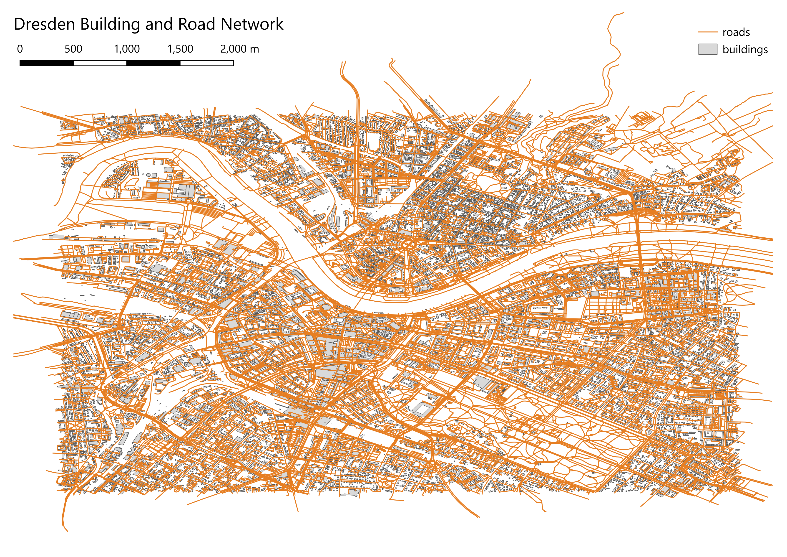

## geospatial-sql-postgis

A geospatial data engineering project using PostgreSQL,
PostGIS, Python, and QGIS to analyze building footprints
and road networks in Dresden, Germany.

### Project Overview

The project integrates Overture Maps building and road
datasets into a PostgreSQL/PostGIS database using Python.

Spatial SQL queries are used to analyze building
characteristics, road proximity, and query performance.

### Key Results

- 17,123 building footprints processed.
- 20,786 road segments processed.
- 99.84% of buildings located within 50 m of a road segment.
- Average nearest-road distance: 8.09 m.

### Result Snapshot

### Technologies

Python | PostgreSQL | PostGIS | SQL | Docker | QGIS

**Keywords:** Geospatial Data Engineering, Spatial SQL,
PostGIS, Spatial JOIN, GiST Indexing, ETL, QGIS.

**Data Source:** Overture Maps.
